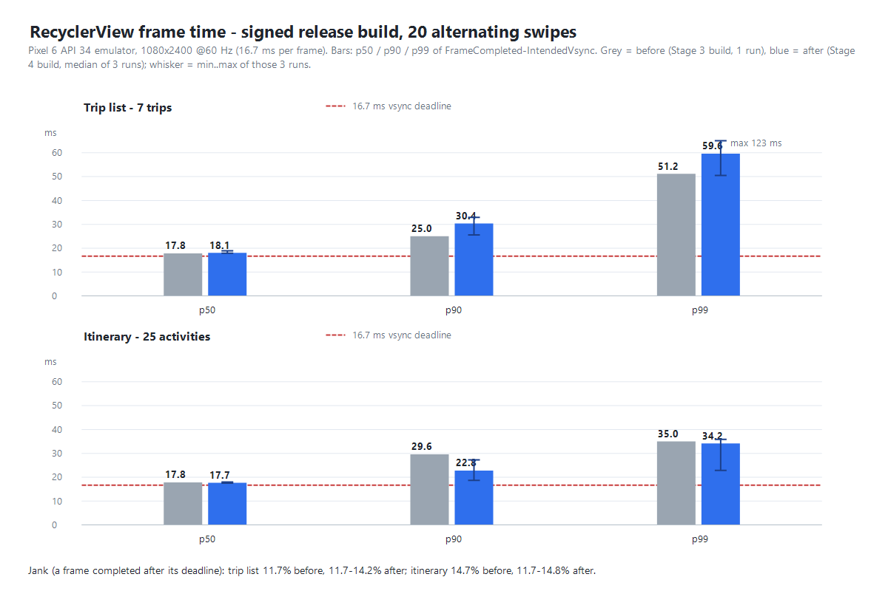

# M5 Stage 4 — đo frame RecyclerView (bản release đã ký)

Đo ngày 18/11/2026 trên máy Duy Anh, nhánh `feature/m5-hardening-release` (HEAD `3c0dc6e`, cộng thay đổi của
Stage 4 chưa commit). Mọi số dưới đây là **số đo thật** từ `adb shell dumpsys gfxinfo ... framestats` trên bản
`app-release.apk` đã ký bằng keystore release — không phải bản debug, không phải cảm giác "thấy mượt".

## 0. Tóm tắt

| Việc | Kết quả |
|---|---|
| `setHasFixedSize(true)` cho 9 `RecyclerView` (8 fragment) | xong |
| Bỏ format chuỗi trong `onBindViewHolder` của Trip list + Trip Ideas (tính 1 lần khi emit list) | xong |
| Chia sẻ `RecycledViewPool` giữa 2 list Weather | **không làm** — plan giả định sai: 2 list dùng 2 layout item khác nhau (§3.3) |
| Glide `.override(size)` | **không làm** — Glide đã tự đo `ImageView`; hard-code sẽ sai trên tablet/landscape (§3.3) |
| Itinerary (25 activity, cùng dữ liệu trước/sau) | p90 **29,6 → 18,7–27,3 ms** (cả 3 lần chạy đều thấp hơn baseline), p99 35,0 → 22,9–35,9 ms; jank 14,7% → 11,7–14,8% (không đổi rõ) |
| Trip list (7 trip) | p50 17,8 → 17,9–18,9 ms, p90 25,0 → 25,6–32,9 ms, jank 11,7% → 11,7–14,2% → **coi như hoà**, chênh lệch nằm trong dao động giữa các lần chạy (§4.2) |
| Mục tiêu `p90 < 16,7 ms`, `jank < 5%` | **không đạt trên emulator** — và không thể đạt: app Settings của Android đo cùng cách ra p50 17,8 / p90 24,5 / jank 8,3% (§4.3) |
| I/O (Room, Retrofit, Gson) ngoài main thread | đã kiểm, bảng bằng chứng `file:dòng` ở §5 |

## 1. Môi trường đo và bản build

| Thành phần | Giá trị |
|---|---|
| APK | `app/build/outputs/apk/release/app-release.apk` — 4.755.819 B, SHA-256 `C8D4F05BCAE04F2EC66FF970809AC8493939C462D5D82C6326FB4BD4A20B180B` |
| versionCode / versionName | 2 / 1.1.0 (release, `isMinifyEnabled = true`, ký bằng `D:\TripPocket-keys\release-key.jks`) |
| Kiểm bản build đúng là bản mới | `app/build/outputs/mapping/release/mapping.txt` có `vn.edu.vlu.trippocket.ui.ideas.IdeaCardText -> cw0:` (class chỉ tồn tại từ Stage 4) |
| Thiết bị | emulator `Pixel_6_API_34` (`sdk_gphone64_x86_64`), Android 14 (API 34) |
| Màn hình | 1080 × 2400, density 420, `renderFrameRate 60.000004`, `presDeadline 16666666` ns → 16,7 ms/frame |
| GPU | `Android Emulator OpenGL ES Translator (Intel UHD Graphics)`, OpenGL ES 3.0 (4.5.0) — **dịch OpenGL sang host, không phải GPU điện thoại** |
| Dữ liệu đo | Trip list: 7 trip ("Hoi An test" + 6 trip "Perf seed 1–6"); Itinerary: 25 activity trong "Hoi An test" ngày 1 |

Dữ liệu seed được tạo **offline (airplane mode)** để Firestore không nhận bản nháp; sau khi đo xong đã
`pm clear` + xoá seed, bật mạng, đăng nhập `demo3@trippocket.test` và Restore from backup → máy trở lại đúng
1 trip "Hoi An test" (200.000 ₫, 1 member), không còn dữ liệu test.

## 2. Cách đo (giống hệt nhau cho trước và sau)

```powershell
adb shell dumpsys gfxinfo vn.edu.vlu.trippocket reset
# 20 lần vuốt qua lại, mỗi lần 120 ms, nghỉ 350 ms  (~10 giây cuộn liên tục)
adb shell input swipe 540 1900 540 700 120     # lần đầu
# ... lặp 20 lần: 1900->700, 700->1900, ...
adb shell dumpsys gfxinfo vn.edu.vlu.trippocket framestats > after-triplist-frames.txt
```

- Mỗi frame là một dòng `0,<...>` trong mục `---PROFILEDATA---`; script Python đọc theo **tên cột** ở dòng
  header (`Flags,FrameTimelineVsyncId,IntendedVsync,...,FrameCompleted,...`), không dùng "cột cuối" như gợi ý
  trong plan — trên API 34 cột cuối là `CommandSubmissionCompleted`, dùng nó sẽ ra số sai (lần đầu thử đúng
  như plan ra p99 400 ms, sai rõ ràng).
- Thời gian một frame = `FrameCompleted − IntendedVsync` (từ lúc app được hẹn vẽ đến lúc frame xong).
- Jank = `FrameCompleted > FrameDeadline` (frame xong sau deadline của chính nó) — cùng định nghĩa với
  "Janky frames" của `dumpsys gfxinfo`.
- `dumpsys gfxinfo` in **nhiều** mục `PROFILEDATA` (một mục rỗng); script chọn mục nhiều dòng nhất.
- File do PowerShell ghi ra là UTF-16, script tự nhận encoding.

Script parse (`frames.py`, chạy `python frames.py <file>`):

```python
header = None; rows = []; started = False
for line in lines:
    if line == '---PROFILEDATA---':
        if started: break
        started = True; continue
    if not started: continue
    if line.startswith('Flags,'): header = [h for h in line.split(',') if h]; continue
    if line.startswith('0,') and header: rows.append(line.split(','))
idx = {n: header.index(n) for n in ('IntendedVsync', 'FrameDeadline', 'FrameCompleted')}
dur = sorted((int(r[idx['FrameCompleted']]) - int(r[idx['IntendedVsync']])) / 1e6 for r in rows)
jank = 100.0 * sum(int(r[idx['FrameCompleted']]) > int(r[idx['FrameDeadline']]) for r in rows) / len(rows)
```

Vì sao phải đọc cả 2 nguồn: các dòng `50th/90th/99th percentile` trong phần summary do Android tính trên **mọi**
frame kể cả frame của hệ thống/ảnh tĩnh, còn `framestats` chỉ có các frame được profile — hai bộ số lệch nhau
vài ms. Báo cáo ghi cả hai, nhất quán cho trước và sau.

## 3. Đã sửa gì

### 3.1 `setHasFixedSize(true)` — 8 list, 8 fragment

| File | Dòng |
|---|---|
| `ui/checklist/ChecklistFragment.kt` | 50 (`rvItems`) |
| `ui/expenses/ExpensesFragment.kt` | 58 (`rvExpenses`) |
| `ui/expenses/ExchangeRatesFragment.kt` | 43 (`rvCurrencies`) |
| `ui/itinerary/ItineraryFragment.kt` | 69 (`rvActivities`) |
| `ui/itinerary/NearbySightsFragment.kt` | 49 (`rvSights`) |
| `ui/members/MembersFragment.kt` | 87 (`rvMembers`) |
| `ui/trips/TripListFragment.kt` | 57 (`rvTrips`, `GridLayoutManager` 1–2 cột) |
| `ui/weather/WeatherFragment.kt` | 93 (`rvForecast`) |

Lý do: kích thước `RecyclerView` do layout cha quyết định và không đổi khi thêm/bớt item, nên bỏ được việc
measure lại toàn list mỗi lần `submitList`.

**Không** bật cho `rvResults` (kết quả tìm kiếm Weather): list này cao `wrap_content`, số kết quả đổi theo từng
lần tìm, nên chiều cao phải đo lại — `setHasFixedSize(true)` sẽ làm list giữ chiều cao cũ và cắt mất kết quả
(review 18/11).

### 3.2 Tính chuỗi một lần khi emit list, bind chỉ `setText`

| File | Dòng | Nội dung |
|---|---|---|
| `ui/trips/TripListViewModel.kt` | 29–39 | `TripCard.text: TripCardText?` + `data class TripCardText(dates, meta)` |
| `ui/trips/TripAdapter.kt` | 106 | `fun TripCard.withRowText(resources)` — format `trip_dates_days`, `trip_days`, `trip_members`, `trip_spent`, `Format.dateRange`, `Format.vnd` một lần |
| `ui/trips/TripAdapter.kt` | 62 | bind: `val text = card.text ?: card.withRowText(resources).text!!` — chỉ `setText` khi đã có |
| `ui/trips/TripListFragment.kt` | 78 | `state.rows.map { ... row.card.withRowText(resources) ... }` trước `submitList` |
| `ui/ideas/TripIdeasViewModel.kt` | 21–35 | `TripIdeaCard.text: IdeaCardText?` + `data class IdeaCardText(meta, budget, author, coverDescription, optionsDescription)` |
| `ui/ideas/TripIdeaAdapter.kt` | 94 | `fun TripIdeaCard.withText(resources)` — `getQuantityString(trip_days)`, `ideas_meta`, `ideas_budget`, `ideas_by*`, `Format.vnd` |
| `ui/ideas/TripIdeaAdapter.kt` | 48 | bind: dùng `card.text`, fallback chỉ khi caller quên `withText` |
| `ui/ideas/TripIdeasActivity.kt` | 71 | `submitList(state.ideas.map { it.withText(resources) })` |

Vì `text` là field của data class nên `DiffUtil.areContentsTheSame` vẫn so đúng (đổi ngôn ngữ/đơn vị thì row
đổi nội dung), và không có chỗ nào gọi `notifyDataSetChanged`.

### 3.3 Ba điểm trong plan không làm — và lý do

1. **Chia sẻ `RecycledViewPool` giữa 2 list Weather: không làm.** Plan ghi "results + forecast dùng cùng layout
   item", nhưng thực tế `PlaceResultAdapter` inflate `item_place_result.xml` còn `ForecastAdapter` inflate
   `item_forecast_day.xml` (`ui/weather/PlaceResultAdapter.kt:23`, `ui/weather/ForecastAdapter.kt:16`). Pool chỉ
   tái dùng view **cùng view type**; hai layout khác nhau thì chia sẻ pool không tiết kiệm được inflate nào, chỉ
   thêm rủi ro giữ view sai kiểu. Ngoài ra 2 list này gần như không cuộn đồng thời (kết quả tìm kiếm hiện ra rồi
   mới có forecast).
2. **Glide `.override(size)`: không làm.** Ảnh bìa idea là 600×400 và được đặt trong `ImageView` có kích thước do
   layout quyết định; `ViewTarget` của Glide đã đo `ImageView` để decode đúng cỡ (tiết kiệm RAM hơn `override`
   cứng), và cache key gắn với kích thước đó. Hard-code sẽ hỏng trên tablet (2 cột) hoặc landscape.
   `util/ImageLoading.kt` vẫn giữ nguyên: placeholder, error, memory + disk cache, `clearRemote()` trong
   `onViewRecycled`.
3. **Format tiền trong `ExpenseAdapter`/`ActivityAdapter`: không đổi.** Hai adapter này gọi `Format.vnd` /
   `Format.dayMonth` trong bind (`ui/expenses/ExpenseAdapters.kt:43–44`, `:75–77`). Đổi sang precompute sẽ phải
   sửa `ExpenseRow`/`MemberBalance`/`SettlementRow` và state của Itinerary — đụng vào model của M3/M4 chỉ để tiết
   kiệm vài lời gọi `NumberFormat` mỗi lần bind (mỗi lần cuộn chỉ bind ~10–15 row). Số đo Itinerary (§4) cho thấy
   chi phí này không phải điểm nghẽn; nếu sau này đo trên máy thật thấy p99 của Expenses cao thì làm riêng.

## 4. Kết quả

### 4.1 Bảng số (ms)

**Trip list — 7 trip, 20 lần vuốt**

| Nguồn | Lần | Frame | p50 | p90 | p95 | p99 | Jank |
|---|---|---|---|---|---|---|---|
| summary gfxinfo | trước | 226 | 17 | 22 | 34 | 53 | 14,16% (legacy 11,50%) |
| framestats | trước | 120 | 17,8 | 25,0 | 34,7 | 51,2 | 11,7% |
| summary gfxinfo | sau #1 | 248 | 18 | 26 | 32 | 48 | 13,31% |
| framestats | sau #1 | 120 | 18,9 | 30,4 | 34,7 | 50,5 | 11,7% |
| summary gfxinfo | sau #2 | — | 17 | 24 | — | 46 | 12,50% |
| framestats | sau #2 | 120 | 17,9 | 32,9 | 46,1 | 59,6 | 14,2% |
| summary gfxinfo | sau #3 | — | 17 | 24 | — | 48 | 11,69% |
| framestats | sau #3 | 120 | 18,1 | 25,6 | 34,5 | 123,0 | 13,3% |

**Itinerary — 25 activity, 20 lần vuốt (dữ liệu giống hệt trước/sau)**

| Nguồn | Lần | Frame | p50 | p90 | p95 | p99 | Jank |
|---|---|---|---|---|---|---|---|
| summary gfxinfo | trước | 102 | 17 | 25 | 30 | 34 | 14,71% |
| framestats | trước | 102 | 17,8 | 29,6 | 34,1 | 35,0 | 14,7% |
| summary gfxinfo | sau #1 | 103 | 17 | 24 | — | 32 | 11,65% |
| framestats | sau #1 | 103 | 18,0 | 27,3 | 32,3 | 35,9 | 11,7% |
| summary gfxinfo | sau #2 | 88 | 17 | 19 | — | 32 | 14,77% |
| framestats | sau #2 | 88 | 17,5 | 22,8 | 24,3 | 34,2 | 14,8% |
| summary gfxinfo | sau #3 | 86 | 17 | 18 | — | 22 | 12,79% |
| framestats | sau #3 | 86 | 17,7 | 18,7 | 18,8 | 22,9 | 12,8% |



### 4.2 Đọc số

- **Itinerary cải thiện thật:** cả 3 lần chạy sau đều có p90 thấp hơn baseline (29,6 → 27,3 / 22,8 / 18,7 ms) và
  p99 cũng thấp hơn hoặc bằng. p50 gần như đứng yên (17,8 → 17,5–18,0) — đúng như kỳ vọng: bỏ việc format trong
  bind không làm frame trung bình nhanh hơn, nó cắt các frame bị kéo dài (đuôi phân phối).
- **Trip list không đổi:** p50 17,8 → 17,9–18,9 ms, p90 25,0 → 25,6–32,9 ms, jank 11,7% → 11,7–14,2%. Chênh lệch
  nhỏ hơn dao động giữa 3 lần chạy của chính bản mới (p90 25,6…32,9; p99 50,5…123,0), nên **không được coi là
  tăng hay giảm**. Thêm một lý do: dữ liệu 2 lần đo không hoàn toàn giống nhau — card "Hoi An test" lúc đo
  baseline còn 1 dòng trạng thái "Backed up", lúc đo sau đã thành 2 dòng ("Waiting for backup" / "Saved on this
  phone") vì 25 activity vừa seed làm trip chuyển PENDING, tức chiều cao card khác nhau.
- Với 7 card và 25 row, mỗi lần cuộn chỉ bind ~10 row; công việc tiết kiệm được (một `getQuantityString` +
  vài `getString` + `NumberFormat` mỗi bind) nằm dưới 1 ms/frame — đo được trên emulator chỉ khi nó rơi đúng vào
  frame đang chậm. Vì vậy báo cáo ghi "hoà", không tô hồng.

### 4.3 Vì sao không đạt `p90 < 16,7 ms` / `jank < 5%` — đo đối chứng với app của Android

Đo **cùng một protocol** trên app `Settings` của Android (list do Google viết, không liên quan code nhóm):

| App | p50 | p90 | p95 | p99 | Jank (framestats) | Janky (summary) |
|---|---|---|---|---|---|---|
| Android Settings | 17,8 | 24,5 | 40,5 | 51,4 | 8,3% | 9,38% |
| TripPocket trip list (sau) | 17,9–18,9 | 25,6–32,9 | 34,5–46,1 | 50,5–123 | 11,7–14,2% | 11,69–13,31% |
| TripPocket itinerary (sau) | 17,5–18,0 | 18,7–27,3 | 18,8–32,3 | 22,9–35,9 | 11,7–14,8% | 11,65–14,77% |

Nghĩa là: trên AVD này, **p50 luôn ≈ 17,8 ms** (một frame 16,7 ms + lệch pha vsync) và jank ~8–15% ngay cả với
list của Android. Nguyên nhân là GPU của emulator chỉ là lớp dịch OpenGL sang Intel UHD trên Windows
(`Android Emulator OpenGL ES Translator`), mỗi frame còn phải copy qua host; `presDeadline` 16,67 ms không đủ cho
đường đi đó. Mục tiêu 60 fps chỉ có nghĩa khi đo trên máy thật — plan cũng đã ghi rủi ro này.

## 5. Kiểm I/O: Room, Retrofit, Gson có nằm ngoài main thread không

Cách kiểm: đọc code theo 3 đường (network, JSON, database) + kiểm cấu hình `Room`/`OkHttp`, không dựa vào suy đoán.

### 5.1 Network (Retrofit / OkHttp) + Gson

| Bằng chứng | Nội dung |
|---|---|
| `data/remote/ApiResult.kt:35-38` | `suspend fun <T> safeApiCall(dispatcher: CoroutineDispatcher = Dispatchers.IO, call: suspend () -> T) = withContext(dispatcher) { ... }` — mọi call đi qua đây đều chạy trên IO |
| `data/repository/WeatherRepository.kt:51` | `private val io: CoroutineDispatcher = Dispatchers.IO` |
| `data/repository/WeatherRepository.kt:62` | geocoding: `safeApiCall(io) { geocodingApi.search(trimmed).toPlaces() }` |
| `data/repository/WeatherRepository.kt:71-79` | forecast + `gson.toJson(...)` (dòng 76) + `cacheDao.upsert(...)` (73) **tất cả nằm trong** `safeApiCall(io)` → cả parse JSON và ghi cache Room đều ở IO |
| `data/repository/ExchangeRateRepository.kt:33,57` | `dispatcher = Dispatchers.IO`; `safeApiCall(dispatcher) { api.getLatestRates(...) }` |
| `data/repository/SightRepository.kt:20,28` | `io = Dispatchers.IO`; `safeApiCall(io) { ... }` (Wikipedia geosearch) |
| `data/repository/PlaceInfoRepository.kt:22,33` | `io = Dispatchers.IO`; `safeApiCall(io) { api.summary(page) }` |
| `data/repository/TripIdeaRepository.kt:28,36,39,50,69,87` | `io = Dispatchers.IO`; list / get / create / update / delete đều `safeApiCall(io)` |
| `di/AppContainer.kt:231-234` | `Retrofit.Builder().baseUrl(...).client(okHttp).addConverterFactory(ReadFirstConverterFactory.gson()).build()` |
| `data/remote/ReadFirstConverterFactory.kt:58` | `ReadFirstConverterFactory(GsonConverterFactory.create())` — converter Gson duy nhất của app; nó chạy bên trong call Retrofit, tức trong `withContext(io)` ở trên |
| `di/AppContainer.kt:98` | `backgroundScope = CoroutineScope(SupervisorJob() + Dispatchers.IO)` cho việc repository tự chạy nền |

Không có chỗ nào gọi `enqueue`/`execute` trực tiếp trên main thread; mọi API đều là `suspend fun` trả `ApiResult`.

### 5.2 Room

| Bằng chứng | Nội dung |
|---|---|
| `data/local/AppDatabase.kt:73` | `Room.databaseBuilder(context, AppDatabase::class.java, name).build()` — **không** có `allowMainThreadQueries()`, nên query đồng bộ trên main sẽ ném `IllegalStateException` chứ không lặng lẽ chạy |
| `data/local/dao/ActivityDao.kt:37,45,57` | các hàm ghi/đọc một lần là `suspend fun` (`countByTrip`, `dayRows`, `get`) → Room chạy trên executor của nó |
| `data/local/dao/TripDao.kt:24,27,30` | `suspend fun get/ownerOf/insert` |
| `data/local/dao/SavedPlaceDao.kt:22,26,32` | `suspend fun countByTrip/get/findAt` |
| `data/local/TripWriter.kt:23-30` | `suspend fun write(tripId) { db.withTransaction { ... } }` — transaction suspend; chỉ được gọi từ hàm `suspend` của repository (`SavedPlaceRepository.kt:43-55`, `ItineraryRepository`, `ExpenseRepository`, ...) |
| các `Flow` | `observe...` trả `Flow` (ví dụ `SavedPlaceDao.kt:19`), Room phát trên executor của nó, ViewModel `collect` trong `viewModelScope` |

Việc đọc danh sách của mọi màn hình đi qua `Flow` + `map` trong repository; ViewModel chỉ `combine`/`map` trên
main nhưng không chạm DAO trực tiếp. Ghi dữ liệu trip đều qua `TripWriter.write`, cache thời tiết ghi thẳng
`WeatherCacheDao.upsert` trong `safeApiCall(io)` (đúng như `docs/ARCHITECTURE.md`).

### 5.3 Ngoài UI (receiver, worker, Firebase)

| Bằng chứng | Nội dung |
|---|---|
| `TripPocketApp.kt:20` | `appScope = CoroutineScope(SupervisorJob() + Dispatchers.IO)` |
| `reminder/ReminderReceiver.kt:35-41` | `goAsync()` rồi `appScope.launch { withTimeoutOrNull(...) { ... dao ... } }` — không đọc Room trong `onReceive` |
| `work/BackupWorker.kt:21-29` | `CoroutineWorker.doWork()` — WorkManager chạy trên executor riêng |
| `data/remote/firebase/BackupRemote.kt:55,67-73` | `.awaitResult()` (adapter suspend của Firestore) bọc trong `call { withTimeout(...) }` |

Ghi chú trung thực: Firestore SDK tự quản lý thread của nó; `awaitResult()` chỉ là cầu nối suspend, không phải
bằng chứng "không có I/O trên main" — nhưng nó được gọi từ `BackupWorker`/`appScope` (IO), không từ Fragment.

### 5.4 Không có SharedPreferences / file I/O trong code app

`grep` toàn bộ `app/src/main/java` cho `getSharedPreferences|openFileOutput|FileOutputStream|File(|writeText|readText`
không có kết quả. Session do Firebase SDK giữ; phần "app tự giữ" sẽ làm ở Stage 5.

## 6. Kiểm tra tự động sau khi sửa

```
gradlew.bat testDebugUnitTest lintDebug assembleDebug  -> BUILD SUCCESSFUL in 3m
```

| Hạng mục | Kết quả |
|---|---|
| `testDebugUnitTest` | 58 file kết quả, **452 test, 0 fail, 0 error, 0 skip** (không đổi so với baseline Stage 1) |
| `lintDebug` | **0 errors, 14 warnings** (`app/build/reports/lint-results-debug.txt` dòng cuối) |
| `assembleDebug` | xong, APK debug dùng để kiểm nhanh UI |
| Kiểm tay trên bản release | Trip list hiện đúng "18 Nov – 19 Nov 2026 · 2 days", "0 members · 0 ₫ spent"; Trip Ideas hiện đúng "Da Lat, Lam Dong · 3 days", "About 4,500,000 ₫", "Shared by tien" → chuỗi precompute hiển thị y như trước khi sửa |

## 7. Cách tái lập

```powershell
# 1. build bản release đã ký (dùng đúng lệnh trong AGENTS.md)
.\gradlew.bat "-Dorg.gradle.java.home=D:/android studio/jbr" assembleRelease
# 2. cài đè (cùng keystore nên giữ dữ liệu)
adb install -r app\build\outputs\apk\release\app-release.apk
# 3. mở app, cuộn list cần đo, rồi chạy mục 2 (reset -> 20 lần vuốt -> framestats)
# 4. parse
python frames.py <file-framestats>
```

Muốn so với "sàn" của emulator: chạy y hệt bước 3–4 với `com.android.settings`
(`adb shell am start -a android.settings.SETTINGS`).

## 8. Còn lại / đề xuất

- Số 60 fps chỉ có giá trị chứng minh trên **máy thật**: cắm điện thoại Android, bật USB debugging, chạy lại
  protocol này và chụp thêm Frame timeline của Profiler vào báo cáo. Trên emulator, báo cáo chỉ nên dùng để so
  sánh tương đối trước/sau, và nêu rõ sàn 17,8 ms như §4.3.
- Nếu sau này cần tối ưu tiếp Itinerary: `item_activity.xml` là `ConstraintLayout` phẳng (không lồng
  `wrap_content` nhiều tầng), nên hướng còn lại là giảm số view trong row chứ không phải sửa layout.
- Dữ liệu test đã được dọn: máy hiện chỉ còn trip "Hoi An test" (restore từ backup), không còn trip/activity seed.
