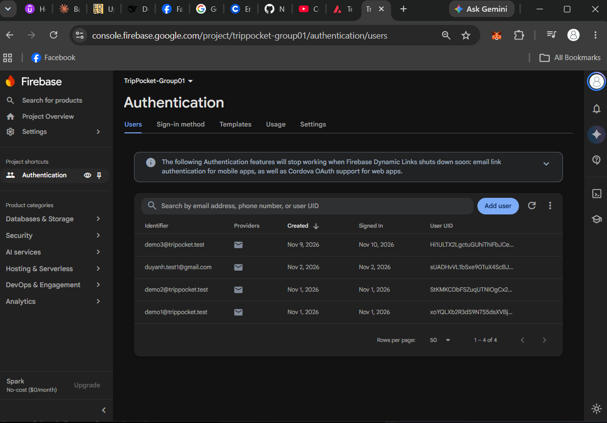
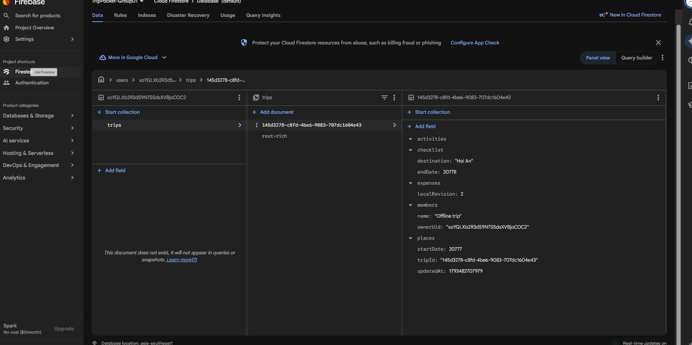
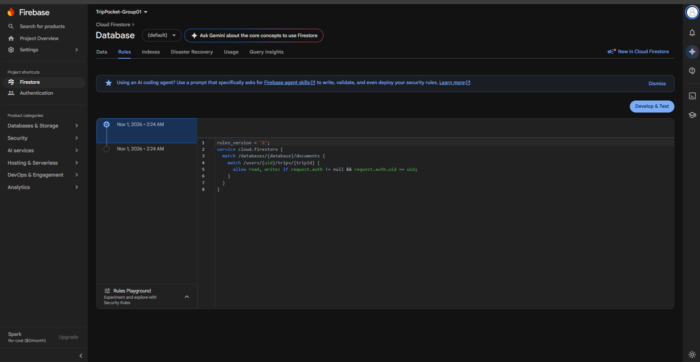
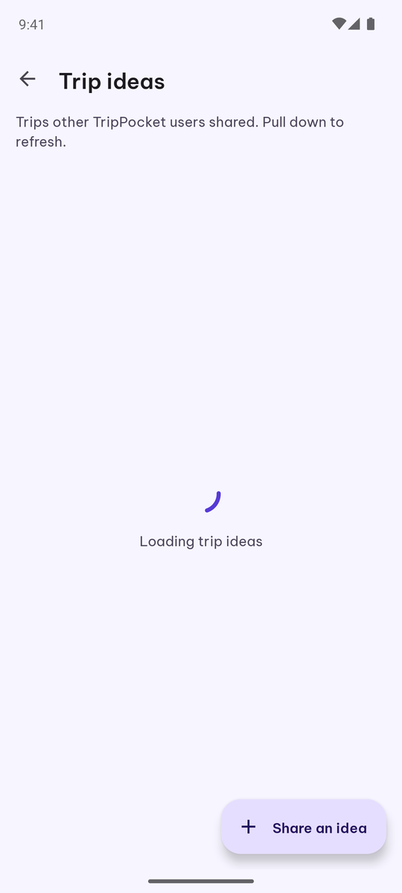
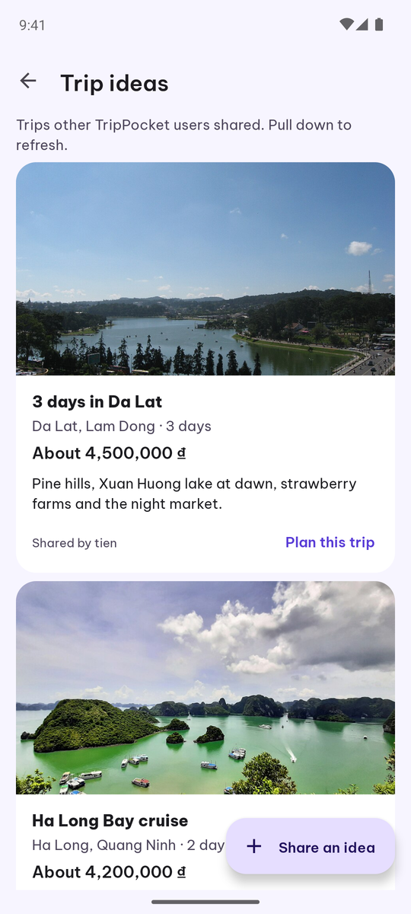
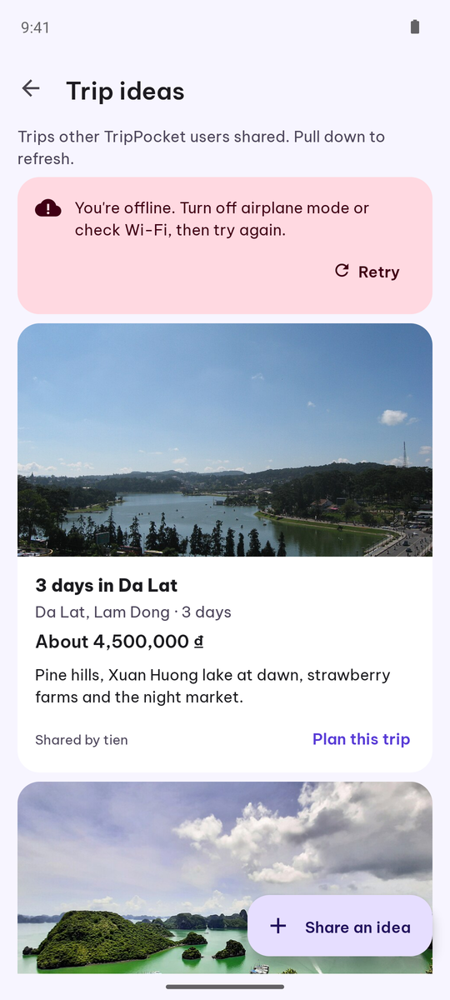
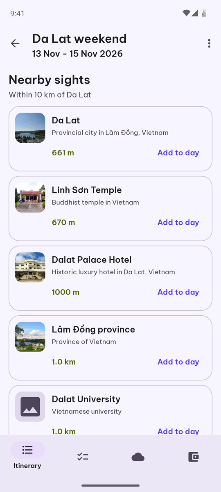
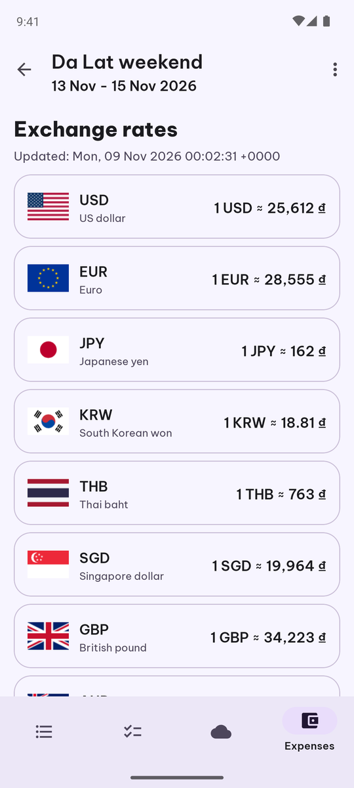
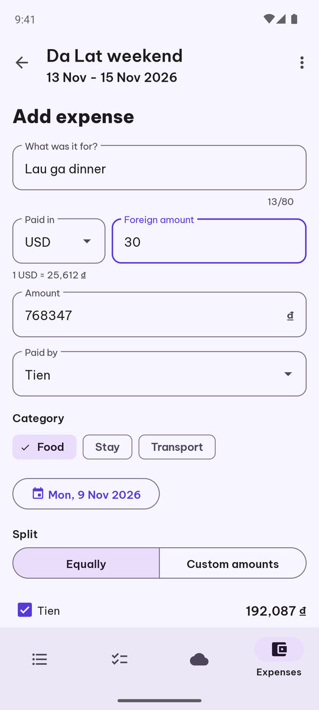
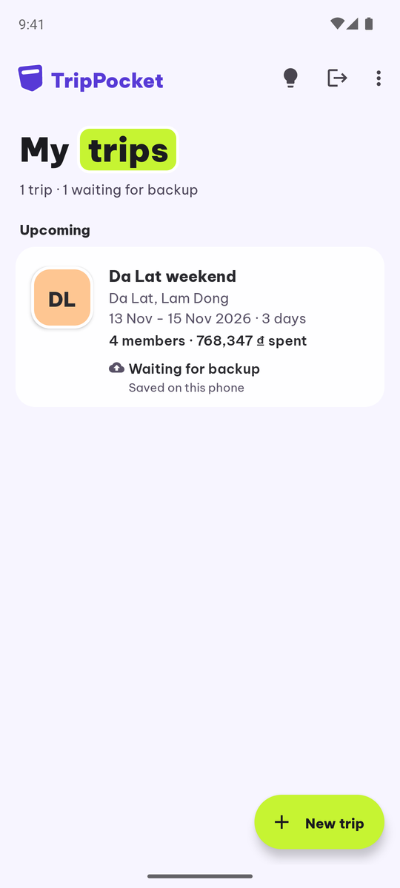

# Worksheet — Milestone 4: Network layer, RESTful API & Cloud services

Nhóm 01 · TripPocket · Ngày chốt: 17/11/2026

| Bản nộp | Ở đâu |
|---|---|
| Repo | https://github.com/NeitLN/TripPocket_Group01 |
| Nhánh phát hành | `main` — commit `47a999b`, bản phát hành `62a2552`, tag **`v1.0`** |
| PR tích hợp M4 | #46 (network/cloud → `develop`), #54 (`develop` → `main`, phát hành) |
| APK | GitHub Release `v1.0`, `app-debug.apk` — SHA-256 `E662B8553B574AB058787981C6F6FB43C034104B3052C3118D9DC0B339BBCC1B` |
| Video demo | https://youtu.be/4aHB0uAgqk4 — *Demo trippocket m4 final*, 1:52, 1920×1080, tiếng Việt có phụ đề từng cảnh (YouTube, chế độ Unlisted) |
| Bằng chứng tự động | `docs/STATUS.md` |

## 0. Video demo — mục lục (1:52)

Xem tại **https://youtu.be/4aHB0uAgqk4** (Unlisted, mở được ở tab ẩn danh). Bản dựng gốc: `D:\TripPocket-video\out\trippocket-m4-final.mp4`.

Quay bằng bản build có `google-services.json` (Firebase thật), tài khoản thử, không lộ mật khẩu. Thời điểm dưới đây
là **xấp xỉ** (lấy theo từng cảnh trong bản dựng):

| Thời điểm | Cảnh | Nội dung |
|---|---|---|
| 0:00 | Mở đầu | TripPocket · Milestone 4 Network & Cloud |
| 0:10 | 1. Đăng ký / đăng nhập Firebase | `Firebase Authentication`, Email + mật khẩu, đăng ký xong vào thẳng app |
| 0:18 | 2. Giữ phiên | Tắt hẳn app rồi mở lại → vào thẳng Trip List, không hỏi đăng nhập |
| 0:26 | 3. MockAPI (CRUD) | `GET /ideas` (vòng tải + danh sách có ảnh bìa Glide), `POST` chia sẻ, `PUT` sửa ngân sách, `DELETE` |
| 0:46 | 4a. Địa điểm | Open-Meteo Geocoding, ảnh Wikipedia (nhiều request song song), Nearby sights |
| 1:06 | 4b. Tỷ giá | open.er-api.com, 12 đồng tiền, cờ tải bằng Glide, "Paid in" USD → VND (Room vẫn lưu VND) |
| 1:20 | 5. Chế độ máy bay | Kéo làm mới khi offline: banner "You're offline" + Retry, danh sách cũ vẫn còn; bật lại mạng → Retry có dữ liệu |
| 1:34 | Lỗi mạng | Bảng quy đổi `ApiError` (OFFLINE / TIMEOUT / NOT_FOUND / RATE_LIMITED / SERVER / BAD_RESPONSE) |
| 1:44 | Kiến trúc | Retrofit → Repository (`safeApiCall`, `Dispatchers.IO`) → ViewModel (`StateFlow` Loading/Success/Error) → UI |
| 1:50 | Kết | Nhóm 01 · Lớp Lập trình ứng dụng di động |

Ba yêu cầu bắt buộc của đề đều có trong video: **app lấy dữ liệu từ API** (cảnh 3, 4a, 4b), **luồng đăng ký/đăng nhập
Firebase** (cảnh 1, 2), **xử lý lỗi khi bật chế độ máy bay** (cảnh 5).

## 1. Ảnh Firebase Console (chụp 17/11/2026, project `TripPocket-GR0up01`)

| Ảnh | Cho thấy gì |
|---|---|
|  | **Authentication → Users**: hai tài khoản thử (`demo1@…`, `demo2@…`), provider Email/Password, cột Signed In ngày 9–10/11 |
|  | **Firestore → Data**: `users/{uid}/trips/{tripId}` — `name: "Offline trip"`, `destination: "Hoi An"`, `startDate: 20777`, `endDate: 20778`, `localRevision: 2`, `updatedAt`, `ownerUid`, cùng các mảng `activities`, `checklist`, `expenses`, `members`, `places` |
|  | **Firestore → Rules** đã publish: `allow read, write: if request.auth != null && request.auth.uid == uid;` — khớp `firestore.rules` trong repo |

Ảnh minh chứng A5 (rules chặn uid khác) nằm ở test tự động, không cần ảnh: `firestore-tests/` chạy bằng
`firebase emulator` trong job `firestore-rules` (xem mục 5).

## 2. Ảnh màn hình app (đã có trong `docs/images/`)

Trích từ bản quay demo ngày 09/11 (cùng bản build đã dựng thành video ở mục đầu), kích thước gốc 1080×2400,
thu nhỏ còn 540×1200 cho nhẹ repo.

**Trip Ideas — vòng tải, tải xong, mất mạng** (MockAPI + Glide, lỗi mạng xử lý bằng banner + Retry):

| `app-loading.png` | `app-loaded.png` | `app-offline.png` |
|---|---|---|
|  |  |  |

**Ba lát còn lại + giữ phiên đăng nhập:**

| `nearby-sights.png` | `exchange-rates.png` | `expenses-paid-in.png` | `trip-list-session.png` |
|---|---|---|---|
|  |  |  |  |
| Wikipedia GeoSearch, khoảng cách từ chuyến | open.er-api.com, cờ tải bằng Glide, dòng "Updated" | Quy đổi USD → VND trước khi lưu Room (Room luôn lưu VND) | Mở lại app vẫn ở Trip List, không hỏi đăng nhập |

Hành vi offline của từng lát (đã sửa ở #53: kéo làm mới lỗi vẫn giữ dữ liệu cũ) xem trong video, cảnh 5.

## 3. Bảng endpoint

Tất cả đều là REST qua Retrofit + OkHttp; response parse bằng Gson (`converter-gson`). Mọi lỗi được quy về
`ApiError` (`OFFLINE`, `TIMEOUT`, `BAD_REQUEST`, `FORBIDDEN`, `NOT_FOUND`, `RATE_LIMITED`, `SERVER`, `BAD_RESPONSE`).

| # | API | Method + path | Dùng cho | File |
|---|---|---|---|---|
| 1 | MockAPI.io `https://6af1cf7c42c6561ced38a850.mockapi.io/api/v1/` | `GET ideas?sortBy=createdAt&order=desc` | Danh sách Trip Ideas | `data/remote/mockapi/TripIdeaApi.kt` |
| 2 | " | `GET ideas/{id}` | Mở một ý tưởng | " |
| 3 | " | `POST ideas` | Chia sẻ ý tưởng mới (JSON body) | " |
| 4 | " | `PUT ideas/{id}` | Sửa ý tưởng | " |
| 5 | " | `DELETE ideas/{id}` | Xoá ý tưởng | " |
| 6 | Wikipedia GeoSearch `https://en.wikipedia.org/` | `GET w/api.php?action=query&generator=geosearch&ggscoord={lat\|lon}&ggsradius=10000&ggslimit=…&prop=pageimages\|description&piprop=thumbnail&pithumbsize=…&format=json&formatversion=2` | Địa điểm gần chuyến (Nearby sights) | `data/remote/wikipedia/GeoSearchApi.kt` |
| 7 | Wikipedia REST | `GET api/rest_v1/page/summary/{title}` | Tóm tắt + ảnh cho một địa điểm | `data/remote/wikipedia/PageSummaryApi.kt` |
| 8 | Open-Meteo Geocoding `https://geocoding-api.open-meteo.com/` | `GET v1/search?name={q}&count=…&language=en&format=json` | Tìm địa điểm để lưu | `data/remote/openmeteo/GeocodingApi.kt` |
| 9 | Open-Meteo Forecast `https://api.open-meteo.com/` | `GET v1/forecast?latitude=…&longitude=…&daily=…&hourly=…&timezone=auto&forecast_days=16` | Thời tiết theo ngày của chuyến | `data/remote/openmeteo/ForecastApi.kt` |
| 10 | Exchange rates `https://open.er-api.com/` | `GET v6/latest/{base}` | Tỷ giá → VND cho tab Expenses | `data/remote/exchangerate/ExchangeRateApi.kt` |
| 11 | FlagCDN (ảnh, không Retrofit) | `GET https://flagcdn.com/w80/{country}.png` | Cờ quốc gia trong danh sách tỷ giá, tải bằng **Glide** | `ui/expenses/CurrencyAdapter.kt` |

Ghi chú lỗi đã xử lý riêng:
- MockAPI: ô "owner" chỉ là dữ liệu — app tự chặn sửa/xoá ý tưởng của tài khoản khác bằng `FORBIDDEN` trước khi gửi.
- Tỷ giá: mã tiền sai vẫn trả HTTP 200 với `{"result":"error"}` → coi là `BAD_RESPONSE`.
- Wikipedia: 404 ở page summary = địa điểm không có ảnh (không phải lỗi màn hình).
- JSON hỏng ở bất kỳ API nào → `BAD_RESPONSE`, không phải `OFFLINE`.

## 4. Retrofit + Coroutines (30%)

- Một `Retrofit` cho mỗi host (`di/AppContainer.kt`), dùng chung `OkHttpClient` có timeout + interceptor.
- Hàm API là `suspend`; repository gọi trong `withContext(Dispatchers.IO)`, lỗi bắt qua `safeApiCall` → `ApiResult.Success|Failure`.
- `CancellationException` luôn được ném lại (không bị `catch (Exception)` nuốt).
- Tìm địa điểm: `debounce(300)` + `flatMapLatest` → huỷ request cũ khi gõ tiếp.
- 452 unit test, trong đó `ExchangeRateRepositoryTest`, `TripIdeaRepositoryTest`, `PlaceInfoRepositoryTest`,
  `WeatherRepositoryTest`, `NearbySightsViewModelTest`, `FullTripSnapshotSizeTest` phủ đúng các nhánh lỗi trên
  (MockWebServer).

## 5. Firebase Auth + Glide (30%)

- **Auth**: `FirebaseAuth` email/password; `LoginViewModel` phân biệt sai mật khẩu, email sai định dạng, mất mạng;
  giữ phiên khi mở lại app; đăng xuất huỷ phiên rồi dừng worker backup.
- **Firestore backup/restore**: `users/{uid}/trips/{tripId}` qua WorkManager; `firestore.rules` chỉ cho uid sở hữu
  đọc/ghi; restore kiểm toàn bộ snapshot trước khi ghi (A4).
- **A5 (kích thước + rules)**: `FullTripSnapshotSizeTest` đo snapshot đầy giới hạn qua mapper thật (dưới 1 MiB);
  `firestore-tests/` chạy 2 tài khoản trên Firestore emulator, job CI `firestore-rules`.
- **Glide**: ảnh bìa Trip Ideas, ảnh địa điểm (Wikipedia thumbnail), cờ quốc gia (FlagCDN) — đều có placeholder và
  ảnh lỗi, `clear()` trong `onViewRecycled` để không giữ bitmap.

## 6. MVVM đúng luồng (20%)

```
REST API (Retrofit)  ->  Repository (suspend, Dispatchers.IO, ApiResult)  ->  ViewModel (StateFlow<UiState>)
                     ->  Fragment/Activity (ViewBinding, repeatOnLifecycle(STARTED))  ->  RecyclerView adapter
```

- Không Fragment nào gọi Retrofit/DAO; ViewModel không giữ `Context`/View; repository tiêm qua `AppContainer`.
- UI state là `sealed interface` `Loading / Success / Error / Empty`; kéo-làm-mới lỗi vẫn giữ dữ liệu cũ + banner.
- Ghi dữ liệu trip qua `TripWriter` trong một transaction, giới hạn qua `Limits`.

## 7. Git + WBS (20%)

`git shortlog -sn --no-merges main`: Tiến 36 · Duy Anh 25 · Minh 17 · Bảo 16 (commit trên `main`, chưa tính commit
merge). Mỗi người có commit ở **cả 4 module**, đúng yêu cầu xoay vòng của proposal mục 5.

| Người | Auth/Trips/Backup | Itinerary | Weather | Expenses | Nhánh M4 |
|---|---|---|---|---|---|
| Tiến | A3 (#24), A4 (#25) | I2 (#22, #49) | W5 (#27) | E4 (#26) | `feature/tien-*` |
| Bảo | A2 (#18) | I1 (#12), I4 (#20, #29) | W4 (#19) | E3 (#21) | `feature/bao-M4-nearby-sights` (#52) |
| Duy Anh | A1 (#8, #23) | I3 (#14) | W1 (#9, #16), W3 (#9, #28, #38) | E1 (#6, #7) | `feature/duyanh-M4-*` (#41, #43, #44, #45) |
| Minh | A5 (#3, #33, #34) | I5 (#5) | W2 (#4) | E2 (#2, #32) | `feature/minh-M4-exchange-rates` (#53) |

WBS theo tuần (rút từ `docs/ROADMAP.md`):

| Tuần | Việc | Ai | Kết quả |
|---|---|---|---|
| 1 (20–26/10) | F0: Room 8 bảng, `TripWriter`, `Limits`, `AppContainer`, Retrofit khung, 4 tab | Tiến + cả nhóm | gate F0 PASS 31/10 |
| 2 (27/10–02/11) | A1, A2, I1, I3, W1, E1 + bộ nhận diện sticker | chia theo xoay vòng | M0, M1 |
| 3 (03–09/11) | A3, A4, I2, I4, I5, W2, W3, W4, W5, E2, E3, E4, X1 từng đợt | cả nhóm | M2 |
| 4 (10–17/11) | M4: MockAPI CRUD, Wikipedia, tỷ giá, ảnh Glide, Firebase session; A5 rules + kích thước; release gate; `main` + tag `v1.0` | cả nhóm | M3 |

## 8. Đối chiếu rubric

| Phần | Trọng số | Bằng chứng |
|---|---|---|
| Retrofit + Coroutines | 30% | mục 3, 4 — 11 endpoint, `suspend` + `Dispatchers.IO`, `flatMapLatest`, test MockWebServer |
| Firebase Auth + Glide | 30% | mục 1, 5 — Firebase Console, `firestore.rules` + job emulator, Glide 3 chỗ |
| MVVM đúng luồng | 20% | mục 6 — `StateFlow`, `repeatOnLifecycle`, ViewBinding, không Context trong ViewModel |
| Git + WBS | 20% | mục 7 — commit từng người ở cả 4 module, PR theo từng lát, WBS 4 tuần |
